<div align="center">

# GeoInfer: offline building mapping from SAR and optical satellite images

**Map every building in a satellite scene on your own computer, with no internet connection.**
Pick an image, draw an area, press *Find buildings*, and get outlines, areas and a
georeferenced mask in seconds.

[](https://github.com/jarvisxys/geoinfer-airgap/actions/workflows/ci.yml)
[](https://github.com/jarvisxys/geoinfer-airgap/releases/latest)
[](pyproject.toml)
[](LICENSE)
[](DATA_LICENSE.md)
[](report/report.pdf)

[**Download**](#download-and-install) ·
[**Demo video**](#demo-video) ·
[**How to use**](#using-the-app) ·
[**Results**](#results) ·
[**Report (PDF)**](report/report.pdf) ·
[**For developers**](#for-developers)

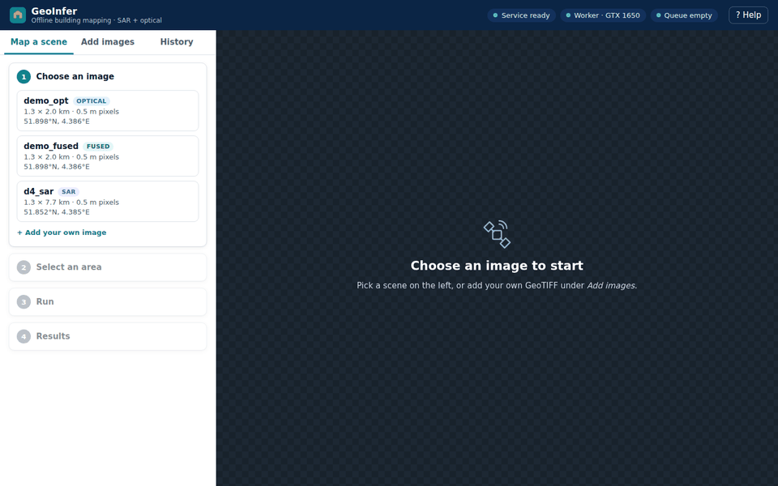

</div>

---

## What it does

GeoInfer is a complete, installable application for finding buildings in high-resolution
satellite imagery. It works with **optical** images (like a photo), **SAR radar** images
(which see through cloud and at night), or **both fused together**.

- **Runs fully offline.** One downloaded bundle holds the app, the trained models and a demo
  scene. After installation nothing is fetched from the internet, so it suits secure or
  disconnected sites (an *air-gapped* network).
- **Handles whole scenes.** Images far larger than the GPU are processed in overlapping tiles
  and stitched back without visible seams.
- **Easy to use.** A web page on your own machine (`http://127.0.0.1:8000`) guides you through
  four steps. You can also upload your own GeoTIFF; the app checks it and fixes the
  projection for you.
- **Measured, not guessed.** Every design choice (stitching, SAR filtering, fusion, inference
  engine, batching, queue policy) was tested against a baseline. The numbers are below and
  in the [report](report/report.pdf).

Built as course project **HSR-AIML-034** (Digital Image Processing), on the public
[SpaceNet 6](https://spacenet.ai/sn6-challenge/) Rotterdam dataset (0.5 m airborne SAR and
WorldView-2 optical, about 48,000 labelled buildings). Industry reference: GalaxEye Space.

## Demo video

> 🎬 **3-minute walkthrough: coming soon.** The link will be added here.

<!-- Replace the line above with:
[](https://www.youtube.com/watch?v=VIDEO_ID)
-->

## Screenshots

| Choose an image | Draw an area |
|---|---|
| 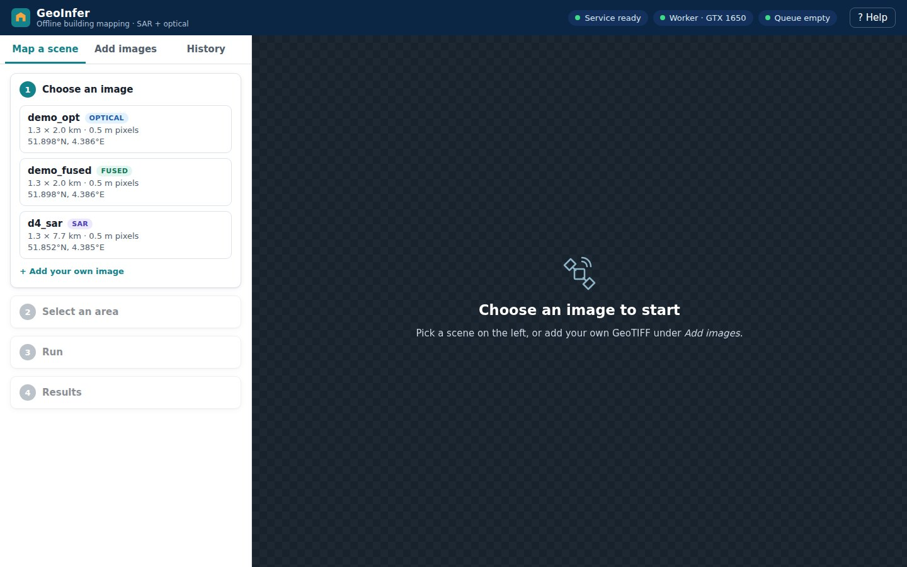 | 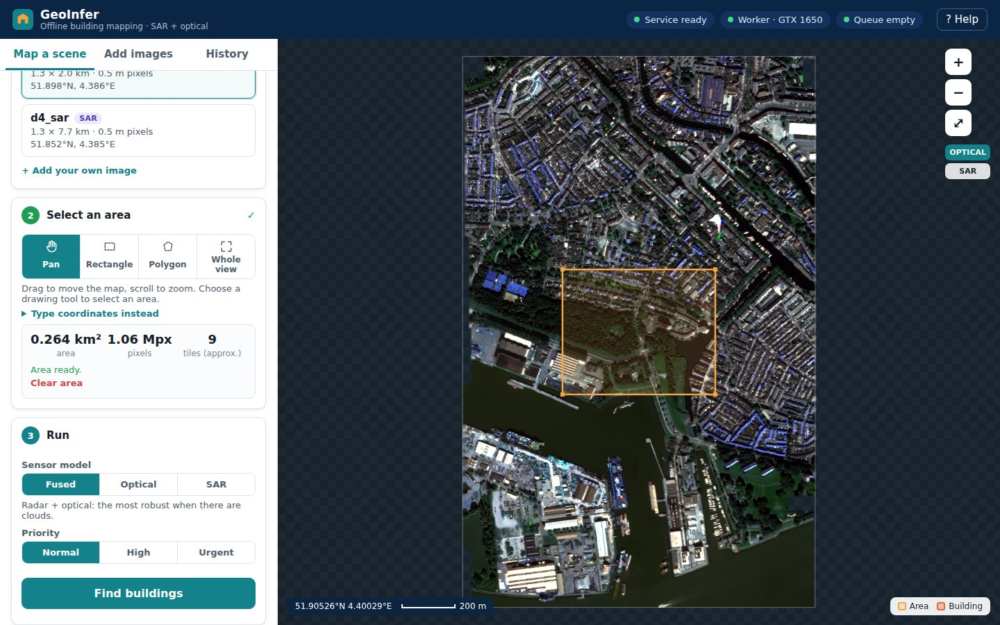 |
| **Results: count, area, stage timings, downloads** | **Click any building for its area and confidence** |
| 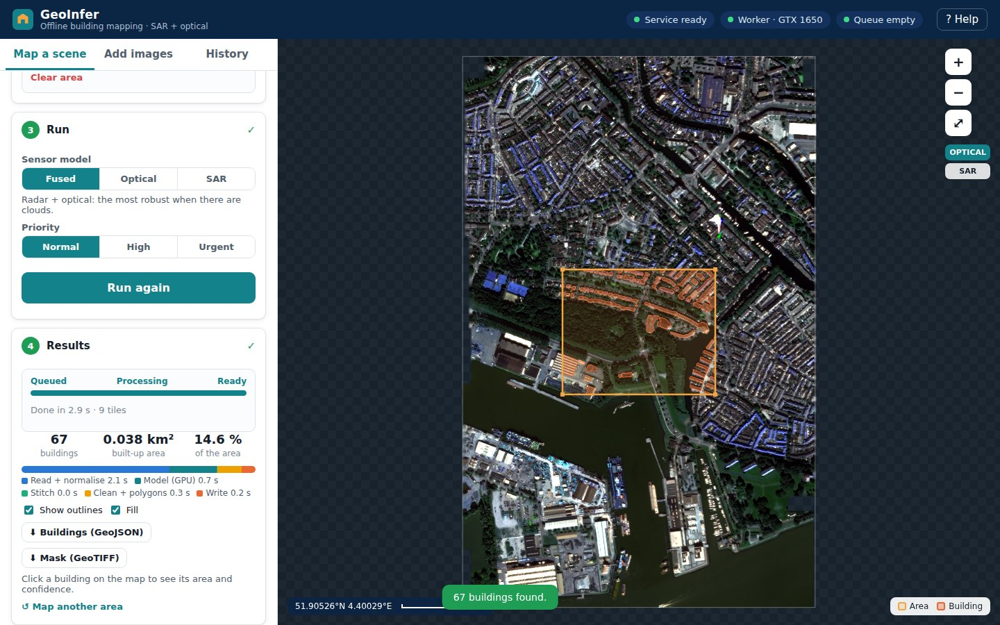 | 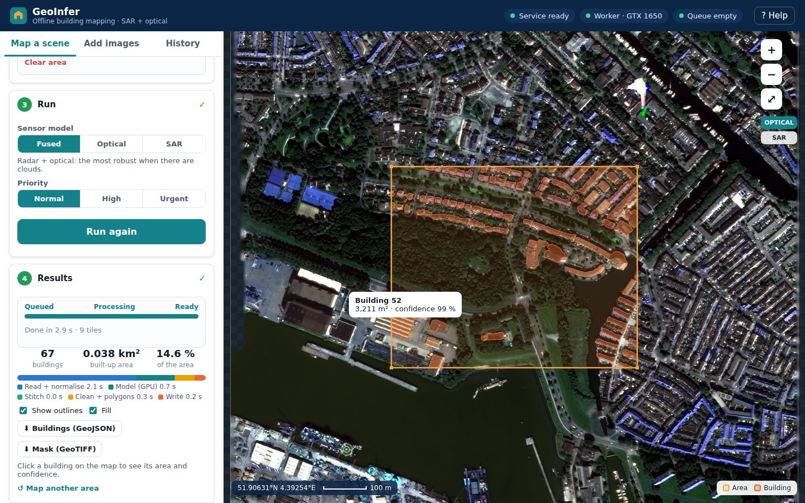 |
| **Add your own GeoTIFF: checked in plain language** | **History: reopen any earlier job** |
| 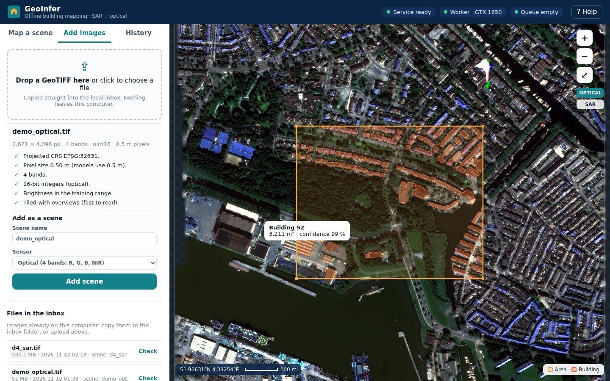 | 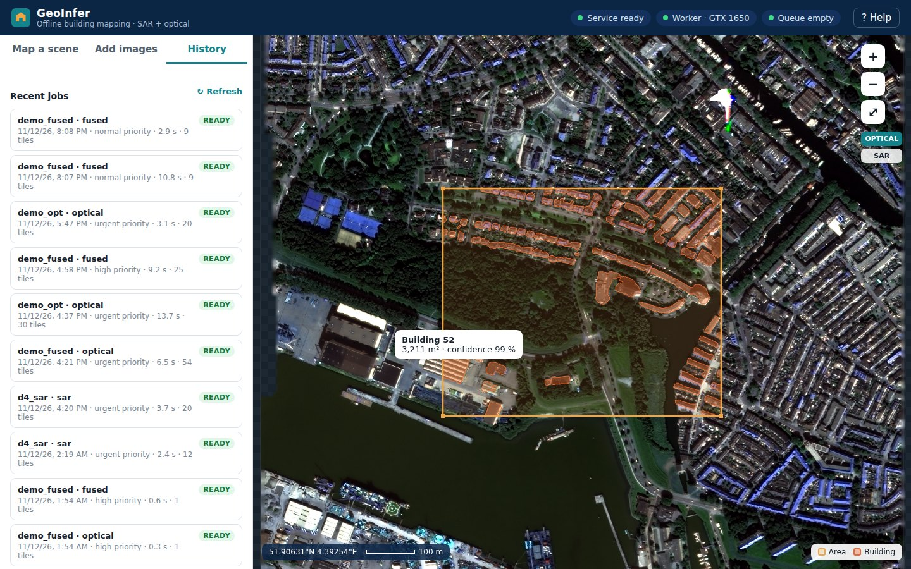 |

## What is new compared with existing work

| | SpaceNet 6 challenge entries | Cloud geospatial ML platforms | **GeoInfer (this project)** |
|---|---|---|---|
| Where it runs | research scripts | vendor cloud, needs internet | **your machine, fully offline**, one checksummed bundle |
| Unit of work | fixed 450 m test tiles | whole scenes | **whole scenes** of any size, streamed window by window |
| Stitching | not evaluated | not reported | **measured**: seam score 3.23 → 0.99 with Hann blending (S1) |
| SAR pre-processing | chosen ad hoc | n/a | **controlled study** over 3 seeds: dB vs linear, Lee 5/7, per-strip statistics (S2) |
| Sensor fusion | optical for pre-training only | rare | **SAR + optical fused**, trained with synthetic clouds; stays above SAR alone up to 80 % cloud (S3) |
| Serving | none | autoscaling, opaque | **measured**: FP16/TensorRT on 2 GPUs, cross-job batching +30 % throughput, priority queue −89 % p95 for urgent jobs |
| Who can use it | ML engineers | subscribers | **anyone with an NVIDIA GPU**: guided web UI, upload your own image |

Details and references are in section 2 of the [report](report/report.pdf).

## How it works

```mermaid
flowchart LR
    U([Analyst<br/>web UI or REST]) -->|scene + area + model| API[FastAPI<br/>validate, reply 202]
    API --> DB[(PostGIS<br/>job queue + results)]
    DB -->|worker claims job<br/>SKIP LOCKED| IO

    subgraph W [GPU worker: DIP core + model]
        direction LR
        IO[COG windowed read] --> N[Normalise<br/>stretch / dB / Lee]
        N --> T[Overlap tiling<br/>512 px, reflect pad]
        T --> M{{U-Net ResNet-34<br/>ONNX Runtime / TensorRT<br/>cross-job batches}}
        M --> S[Hann-weighted stitch<br/>disk-backed]
        S --> P[Threshold + open/close<br/>+ min area]
        P --> V[Vectorise + simplify]
    end

    V --> O[/mask.tif COG<br/>buildings.geojson<br/>PostGIS rows/]
    O --> U
```

Three containers on a private Docker network: **api** (FastAPI and the web UI), **worker**
(the image-processing pipeline and the model on the GPU) and **db** (PostGIS: scenes, jobs,
building polygons and the job queue). The graded image-processing core is in
[`src/geoinfer/{io,preprocess,tiling,postprocess,eval}`](src/geoinfer); every stage is
unit-tested on synthetic arrays and keeps the input georeferencing.

## Download and install

### What you need

| | Minimum | Tested on |
|---|---|---|
| GPU | NVIDIA, 4 GB, driver **580 or newer** (CUDA 13) | GTX 1650 4 GB (laptop), RTX PRO 6000 |
| OS | Windows 10/11 with WSL2, or Linux | Windows 11 + WSL2 Ubuntu 24.04 |
| Software | [Docker Desktop](https://www.docker.com/products/docker-desktop/) (Windows) or Docker Engine + [NVIDIA Container Toolkit](https://docs.nvidia.com/datacenter/cloud-native/container-toolkit/latest/install-guide.html) (Linux) | Docker 29 |
| RAM / disk | 8 GB RAM, **25 GB free** disk (download 5 GB + installed 15 GB) | 4.8 GB given to WSL worked |

### 1. Download

The bundle is about 5 GB, split into three parts because GitHub limits each file to 2 GB.
Click each link; the download starts straight away.

| File | Size | Link |
|---|---|---|
| Installer script | 4 KB | [⬇ install_offline.sh](https://github.com/jarvisxys/geoinfer-airgap/releases/latest/download/install_offline.sh) |
| Bundle part 1 of 3 | 1.9 GB | [⬇ geoinfer-1.0.0.tar.part0](https://github.com/jarvisxys/geoinfer-airgap/releases/latest/download/geoinfer-1.0.0.tar.part0) |
| Bundle part 2 of 3 | 1.9 GB | [⬇ geoinfer-1.0.0.tar.part1](https://github.com/jarvisxys/geoinfer-airgap/releases/latest/download/geoinfer-1.0.0.tar.part1) |
| Bundle part 3 of 3 | 0.9 GB | [⬇ geoinfer-1.0.0.tar.part2](https://github.com/jarvisxys/geoinfer-airgap/releases/latest/download/geoinfer-1.0.0.tar.part2) |
| Checksums | 1 KB | [⬇ SHA256SUMS](https://github.com/jarvisxys/geoinfer-airgap/releases/latest/download/SHA256SUMS) |

All files are also listed on the [latest release](https://github.com/jarvisxys/geoinfer-airgap/releases/latest) page.

### 2. Install (one time, about 10 minutes)

On **Windows**, first make sure Docker Desktop is running and that
*Settings → Resources → WSL integration* is switched on for Ubuntu. Then open **Ubuntu**
(WSL) and run the commands below. If you saved the files in your Windows *Downloads* folder,
replace `<you>` with your Windows user name. On **Linux**, just `cd` to the download folder.

```bash
cd "/mnt/c/Users/<you>/Downloads"

# join the three parts and check the bundle is intact
cat geoinfer-1.0.0.tar.part0 geoinfer-1.0.0.tar.part1 geoinfer-1.0.0.tar.part2 > geoinfer-1.0.0.tar
sha256sum geoinfer-1.0.0.tar
# must print 61773284eb3f02314019f953548aae095fb06b21024d7d7d9b76f58947e61fbe

# install to ~/geoinfer and run a test job per model with networking switched off
bash install_offline.sh geoinfer-1.0.0.tar ~/geoinfer --test
```

The installer checks every file against its SHA-256 checksum, loads the Docker images,
writes a private `.env` with a random database password, copies the demo scene, and runs
one optical, one SAR and one fused job **with the network disabled**. It downloads
nothing. When it finishes you can delete the `.tar` and the parts.

### 3. Start the app

```bash
cd ~/geoinfer && docker compose up -d --wait
```

Open **<http://127.0.0.1:8000>** in your browser. The page is served by your own machine
and only listens on `127.0.0.1`.

| Task | Command (inside `~/geoinfer`) |
|---|---|
| Stop the app | `docker compose down` |
| Start again later | `docker compose up -d --wait` |
| Check health | `curl -s http://127.0.0.1:8000/readyz` → `{"db":true,"worker":true}` |
| See logs | `docker compose logs --tail 50 worker` |
| Strict air-gap mode (API only reachable inside Docker) | `docker compose -f compose.yaml -f compose.airgap.yaml up -d --wait` |
| Reset the database | `docker compose down -v` |
| REST API reference | <http://127.0.0.1:8000/docs> |

## Using the app

1. **Choose an image.** `demo_opt` (optical) and `demo_fused` (SAR + optical) are ready after
   installation: a 1.3 × 2.0 km strip of Rotterdam at 0.5 m.
2. **Select an area.** Drag a rectangle, click a polygon, use the current view, or type
   coordinates. The panel shows the area in km², its size in pixels and the number of tiles.
3. **Run.** Pick the model (*Fused*, *Optical* or *SAR*) and a priority, then press
   **Find buildings**. A 1 km² area takes about 10 s on a GTX 1650.
4. **Results.** Building outlines appear on the map, with the count, built-up area and the
   time spent in each stage. Click a building for its area and confidence. Download
   **GeoJSON** (opens in QGIS or any GIS) or the **mask GeoTIFF**. *Run again* compares
   models on the same area.

### Using your own satellite image

Open **Add images** and drop a GeoTIFF (up to 20 GB). The app checks it and explains any
problem in plain language:

| Check | What the models expect | If not |
|---|---|---|
| Projection | a projected CRS in metres (UTM) | **Prepare image** reprojects it |
| Pixel size | 0.5 m (other sizes are resampled) | **Prepare image** resamples to 0.5 m |
| Bands | exactly 4: optical R, G, B, NIR (16-bit), or SAR HH, HV, VH, VV (float, dB) | not supported: 3-band RGB, 1-band SAR |
| Layout | tiled with overviews (fast to read) | **Prepare image** writes a Cloud-Optimised GeoTIFF |

Then name the scene, pick the sensor, and press **Add scene**. Files already on the machine
can be copied straight into `~/geoinfer/data/inbox/` instead of uploading.

> **Accuracy outside Rotterdam.** The models were trained on 0.5 m WorldView-2 and airborne SAR
> over one Dutch city. Imagery at 0.3–0.6 m of similar cities works best. Coarser imagery
> (for example 10 m Sentinel-2) is resampled and runs, but buildings are only a few pixels
> wide there, so expect poor results.

## Results

All numbers are on a held-out geographic split of SpaceNet 6 (637 tiles, plus 40 Mpx and
121 Mpx scene mosaics). Full tables are in [docs/experiments.md](docs/experiments.md) and
the [report](report/report.pdf).

### Accuracy

| Model | Pixel IoU | Object F1 | At 80 % cloud |
|---|---|---|---|
| Classical Otsu threshold on SAR (baseline) | 0.168 | n/a | n/a |
| SAR U-Net | 0.479 | 0.244 | 0.479 (unaffected) |
| Optical U-Net | 0.682 | 0.508 | 0.501 (cloud-trained) |
| **Fused SAR + optical U-Net** | **0.688** | **0.519** | **0.527** (cloud-trained) |

<table>
<tr>
<td width="50%">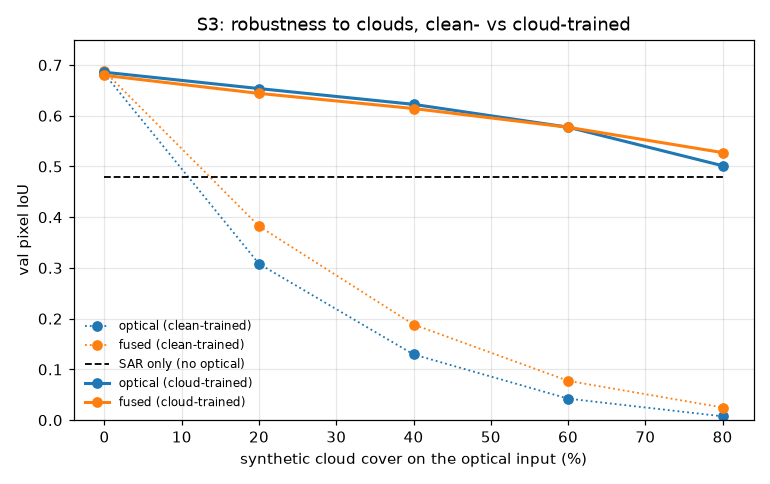<br>
<sub><b>S3: clouds.</b> Trained on clear images, optical and fused models fall below SAR
alone at 20 % cloud. Trained with synthetic clouds, both hold up, and only the fused model
beats SAR at 80 %.</sub></td>
<td width="50%">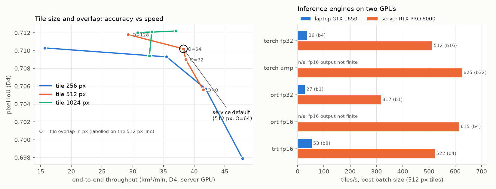<br>
<sub><b>S4: engines.</b> FP16 and TensorRT cost no accuracy (IoU 0.710 everywhere).
TensorRT FP16 doubles laptop throughput (53 vs 27 tiles/s); the server reaches 625 tiles/s.</sub></td>
</tr>
</table>

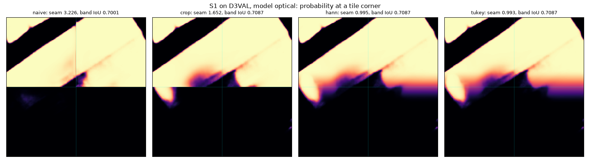
<sub><b>S1: stitching.</b> The same tile corner stitched four ways. Naive pasting leaves a
hard seam (seam score 3.23); Hann or Tukey weighting removes it (0.99) and adds +0.009
border-band IoU on the 121 Mpx validation mosaic.</sub>

### Speed under load (laptop GTX 1650)

| Experiment | Finding |
|---|---|
| E4: offered load | latency flat (p50 4–6 s) up to 0.27 jobs/s (23 km²/min); saturation between 0.27 and 0.37 jobs/s |
| E2: batching | cross-job batching with a 10–25 ms hold-back: **+30 % throughput**, **2.3× lower** median latency than per-job batches |
| E3: queue policy | priority with slow ageing cuts urgent-job p95 from 673 s (FIFO) to **74 s** at 4× load |

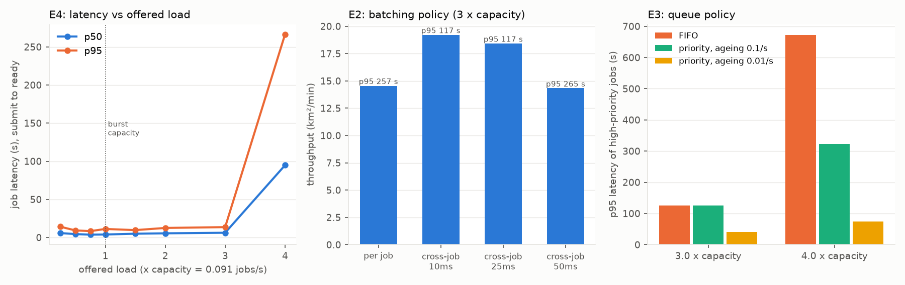

<details>
<summary><b>Success and failure cases</b> (click to expand)</summary>

Blue: correct building pixels, red: false alarms, yellow: missed.

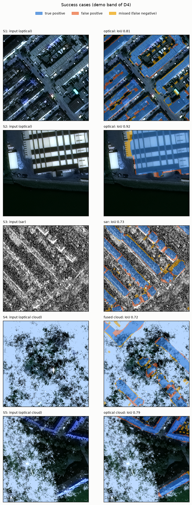 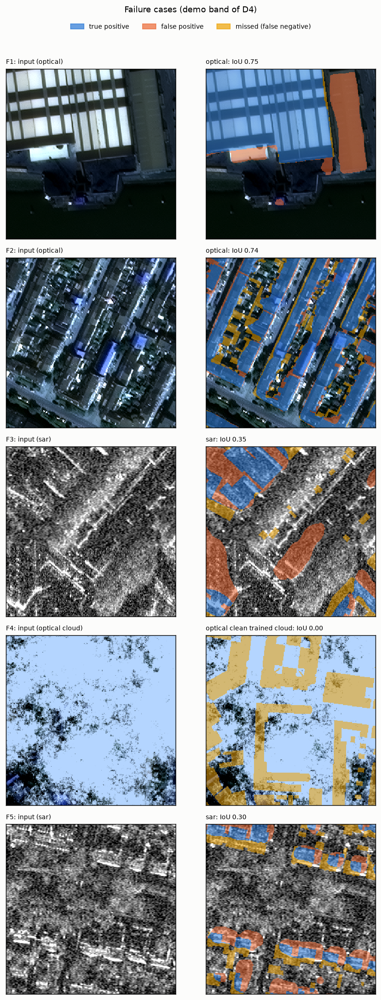

</details>

<details>
<summary><b>All study results</b> (S1–S4, morphology, export)</summary>

| Study | Result |
|---|---|
| S1 stitching | D4 (40 Mpx): seam score 2.79 (naive) → 1.48 (crop) → 0.98 (Hann / Tukey); official Val extent (121 Mpx): +0.009 border-band IoU, +0.010 object F1 |
| S2 SAR | dB vs linear: +0.07 IoU, +0.11 object F1; over 3 seeds the dB arms tie on IoU, per-strip statistics are best on object F1 (0.264 vs 0.248); speckle filtering does not help the CNN |
| S2 optical | per-tile min-max equals a global stretch on tile IoU (0.681 vs 0.682) but leaves seams after stitching (seam score 2.60 vs 0.92) |
| S3 sensors | val pixel IoU / object F1: optical 0.682 / 0.508, SAR 0.479 / 0.244, fused 0.688 / 0.519 |
| S3 clouds | cloud augmentation keeps optical and fused at 0.61–0.62 IoU at 40 % cloud; at 80 % only the fused model (0.527) beats SAR alone |
| S4 engines | GTX 1650 92–97 % busy (TensorRT FP16 53 tiles/s); RTX PRO 6000 23–55 % busy (625 tiles/s): whole-scene jobs are CPU and I/O bound there |
| Tile / overlap | 256 px without overlap: 0.698 IoU at 48 km²/min; 512 px with 64 px overlap (default): 0.710 at 38 km²/min |
| Morphology | clean-up raises SAR object F1 0.223 → 0.244; neutral for optical and fused |
| Export | ONNX matches PyTorch to 2.4e-5 in the logits |
| Gate 3 | clean install from the bundle, air-gapped: optical 0.734 IoU (597 buildings, 32 s), SAR 0.536, fused 0.712 on the demo band |

</details>

## Report

📄 **[report/report.pdf](report/report.pdf)** (14 pages): problem, existing work, data, block
diagram, every DIP stage with intermediate images, models, studies S1–S4, serving
experiments, the offline service, success and failure cases, and limitations. The LaTeX
source is [report/report.tex](report/report.tex); rebuild with `make report` or
`tectonic report/report.tex`.

## For developers

<details>
<summary><b>Set up, test and build the bundle yourself</b></summary>

```bash
git clone https://github.com/jarvisxys/geoinfer-airgap.git && cd geoinfer-airgap
make setup      # uv environment (Python 3.12, torch + CUDA 13) and pre-commit hooks
make check      # ruff, mypy, pytest (CPU)
make env        # torch / CUDA / GPU fingerprint

make images service-models demo-scene   # Docker images, /models, demo scene
make airgap-test                        # internal-only stack, one job per sensor mode
make bundle VERSION=1.0.0               # images + models + wheels + SHA-256 manifest
scripts/split_bundle.sh geoinfer-1.0.0.tar   # parts under 2 GB for a GitHub release
```

Machine setup and the SpaceNet 6 download (`scripts/download_sn6.ps1`, writes to
`D:\geo\raw\sn6`) are in [docs/setup.md](docs/setup.md); the experiment log is
[docs/experiments.md](docs/experiments.md). Model weights and derived data are versioned
with DVC (`dvc pull`).

</details>

<details>
<summary><b>Reproduce the data, figures and models</b></summary>

Data builds (run once, in this order; each writes outside git or into DVC):

| Output | Command | Runtime (laptop, USB drive) |
|---|---|---|
| Split lists `data/splits/*.txt`, `docs/figures/splits_map.png` | `make splits` | ~2 min |
| 200-tile working subset in `~/geo-data/subset` | `make subset` | ~25 min |
| Train-split S2 statistics `data/processed/stats/` (DVC) | `make stats` | ~48 min |
| Per-strip SAR statistics `strip_stats.json` (DVC, decision D4) | `make strip-stats` | ~47 min |
| D4 scene (SAR, optical, labels, strips) | `make d4` | ~17 min |

Figures and tables (`make figures` rebuilds all of them, ~7 min):

| Figure / table (`docs/figures/`) | Command | Runtime |
|---|---|---|
| Gate 0 quick-look `gate0_sar_optical.png` | `make gate0` | < 10 s |
| S2 figures `s2_*.png` + `s2_metrics.json` (notebook 02) | `make figures-nb` | ~30 s |
| Co-registration `coreg_shifts.{csv,png}` | `make coreg` | ~1 min |
| D4 quick-look `d4_overview.png` | `make d4-quicklook` | < 30 s |
| Post-processing on D4 `postprocess_d4.{png,json}` | `make postprocess-check` | ~1 min |
| S1 dry run (synthetic model) `s1_d4_synthetic.{png,json}` | `make s1` | ~2 min |
| Classical SAR baseline `otsu_d4.{png,json}` | `make otsu` | ~6 min |
| S1 with the trained optical model `s1_d4_optical.{png,json}` | `make s1-optical` | ~6 min |

Models (training ran on a GPU server, see [docs/server_env.md](docs/server_env.md) and
`scripts/server/`):

| Output | Command | Where / runtime |
|---|---|---|
| Laptop sanity check (overfit 8 tiles) | `make overfit` | laptop, ~16 min |
| S3 models (optical, SAR, fused) | `scripts/server/remote_train.sh` | server, 30-75 min |
| S2 arms; seed repeats | `remote_s2.sh`; `remote_s2_seeds.sh` | server, ~35 min each |
| Cloud-trained S3 arm | `remote_s3_clouds.sh` | server, ~40 min |
| Val evaluation (`eval.json`) | `remote_eval.sh <run>` | server, ~5 min per run |
| Cloud curves `s3_clouds*.json`, `s3_clouds_all.png` | `remote_cloud.sh`; `scripts/plot_cloud_curves.py` | server, ~10 min per model |
| ONNX export + parity check | `make export` | laptop, ~1 min |
| S4 engines `s4_*.json`, `s4_pareto.png` | `make bench` (see `configs/bench.yaml`) | laptop / server |
| Serving experiments `e_load*.json`, `e_load.png` | `scripts/load_experiments.py`; `scripts/plot_load.py` | laptop Docker stack |

</details>

<details>
<summary><b>Repository layout</b></summary>

```
src/geoinfer/   io, preprocess, tiling, models, postprocess, eval, train,
                service/{api, worker, db, ui}, bench
configs/        every parameter (data, training, serving, benchmarks)
scripts/        data download and builds, training on the server, offline bundle
tests/          unit/ (synthetic arrays), integration/ (PostGIS, API, UI)
docker/         Dockerfiles, compose.yaml, compose.airgap.yaml
loadtest/       request generator and open-loop replay
docs/           setup, decisions, experiment log, figures
report/         report.tex and the compiled report.pdf
```

</details>

<details>
<summary><b>Project plan and gates</b></summary>

| Phase | Scope | Tag |
|---|---|---|
| 0 | Environment, repo, CI, data download | |
| 1 | DIP core: I/O, normalisation, despeckling, tiling, stitching, morphology, metrics | `v0.1-dip` |
| 2 | Optical / SAR / fused U-Nets; studies S1–S3 | `v0.2-models` |
| 3 | Offline service: ONNX, FastAPI, worker, Docker, offline bundle (Gate 3) | `v0.3-service` |
| 4 | Benchmarks: S4 engines, E1–E5 serving experiments | `v0.4-bench` |
| 5 | Web UI, report, demo | `v1.0-submission` |

Design decisions D1–D8 are recorded in [docs/decisions.md](docs/decisions.md).

</details>

## Limitations

- Trained on one city (Rotterdam) at 0.5 m; other cities and resolutions will score lower.
- The clouds used in training are synthetic (no shadows or haze).
- One SAR look direction per scene; mosaics that mix directions need per-strip handling.
- Serving experiments ran on a 4 GB laptop GPU; loading all three models fills its memory.

## Licence and credits

Code: MIT ([LICENSE](LICENSE)). SpaceNet 6 data and everything derived from it, including
the bundled models and demo scene: CC BY-SA 4.0 ([DATA_LICENSE.md](DATA_LICENSE.md)).
SpaceNet 6 imagery © SpaceNet / Capella Space / Maxar, released through the SpaceNet
partners on AWS Open Data.
